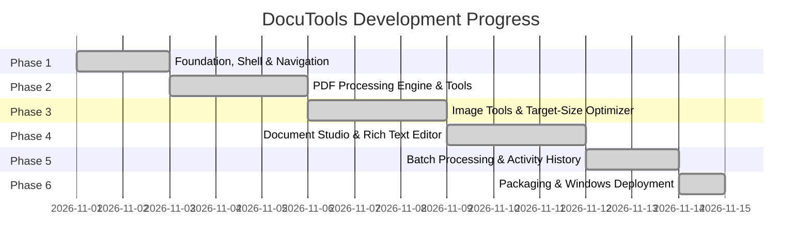

# DocuTools — Development Roadmap & Phase Progress

This document tracks the phased development progress of the **DocuTools** modular Windows desktop application.

---

## Overall Roadmap Status: 🟢 All Phases Implemented & Verified

---

## Detailed Phase Breakdown

### Phase 1 – Application Foundation 🟢 [COMPLETED]
- [x] **Python Environment & Dependencies**: Python 3.13 project structure, clean separation between UI and headless engines.
- [x] **PySide6 Application Shell**: Responsive `MainWindow` (`1300x860`) with `QStackedWidget` layout.
- [x] **Windows 11 Fluent Theme Management**: Dynamic Dark Mode & Light Mode QSS stylesheets with runtime hot-reloading (`styles.py`).
- [x] **Collapsible Navigation Sidebar**: 8-item navigation (Home, PDF Tools, Document Editor, Image Tools, Converter, Batch Processing, History, Settings) with collapse toggle.
- [x] **Universal Drag & Drop Area**: Visual dashed hover feedback, system file dialog fallback, and multi-format acceptance (`DropZone`).
- [x] **Home Dashboard**: Brand header with application icon, Quick Action navigation grid, universal drag-and-drop ingestion zone, and interactive Recent Files table with direct opening and Explorer revealing.
- [x] **Global Keyboard Shortcuts**: `Ctrl+1..8` navigation, `Ctrl+O` open, `Ctrl+S` save, `Ctrl+N` new document, `Ctrl+T` toggle theme, `Ctrl+W` collapse sidebar.

### Phase 2 – PDF Tools 🟢 [COMPLETED]
- [x] **Visual Page Organizer**: Multi-threaded page thumbnail grid with page numbering (`ThumbnailCard`).
- [x] **Page Reordering & Rotation**: Drag/button-based page order manipulation and 90° clockwise rotations.
- [x] **Selective Page Extraction**: Checkbox-based selection to extract custom pages to a new document.
- [x] **PDF Merge**: Combine multiple PDF documents with order sorting (Move Up / Down).
- [x] **PDF Split Modes**:
  - Split by defined page ranges (e.g. `1-3, 5, 8-10`).
  - Split into chunks (every $N$ pages) or single-page extractions.
- [x] **Deep PDF Compression**:
  - `pikepdf` stream compression and object dictionary deflation.
  - Image downsampling for embedded bitmaps with low/medium/high profiles.
  - Before/after size comparison and % savings metrics.
- [x] **Password Protection & Permissions**: AES-256 document encryption, user/owner passwords, printing/copying permission flags.
- [x] **PDF Annotations & Watermarks**: Diagonal security watermarks, corner approval stamps, headers, footers with custom opacity and font sizes.

### Phase 3 – Image Tools 🟢 [COMPLETED]
- [x] **Single Image Studio**: Live image canvas preview, dimensions, aspect ratio, and byte size indicators.
- [x] **Resize Engine**: Aspect-ratio locked width/height inputs, preset scale buttons ($25\%$, $50\%$, $75\%$, $200\%$), and Lanczos/Bicubic resampling.
- [x] **Crop Tool**: Interactive rectangular bounding box cropping.
- [x] **Format Conversion**: Lossless and lossy cross-conversions between JPEG, PNG, WebP, BMP, and TIFF.
- [x] **Iterative Target File-Size Compression**:
  - Binary search quality adjustment for JPEG & WebP targeting exact sizes ($50\text{ KB}$, $100\text{ KB}$, $200\text{ KB}$, $500\text{ KB}$, or custom).
  - Progressive color palette quantization ($256 \to 32$ colors) and compression level 9 for PNGs.
- [x] **Batch Image Optimizer**: Multi-image queue with before/after size tracking and compression percentage reports.

### Phase 4 – Document Editor 🟢 [COMPLETED]
- [x] **Word-Style Rich Text Editor**: Built on Qt's `QTextDocument` and styled `QTextEdit`.
- [x] **DOCX Import & Parsing**: Bridge reading Word documents into formatted HTML preserving headings, bold, italic, underline, colors, lists, and tables.
- [x] **DOCX Authoring & Export**: Export rich HTML back into `.docx` format via `python-docx`.
- [x] **Formatting Toolbar**:
  - Font family dropdown and font size ($8\text{--}72\text{ pt}$).
  - Bold (`Ctrl+B`), Italic (`Ctrl+I`), Underline (`Ctrl+U`), and text/highlight color pickers.
  - Paragraph alignment (Left, Center, Right, Justify).
  - Bulleted and numbered lists.
  - Insert Table dialog (configurable rows & columns).
  - Insert Local Images with automatic document fitting.
- [x] **High-Fidelity PDF Export**: Direct vector PDF rendering via Qt's `QPrinter`.
- [x] **Live Document Statistics**: Real-time word count and character count tracking.

### Phase 5 – Advanced Functionality 🟢 [COMPLETED]
- [x] **Universal Converter**:
  - PDF to Images (custom DPI: $72\text{--}600\text{ DPI}$).
  - Images to PDF (combined or separate).
  - DOCX to PDF (offline vector conversion).
  - PDF to Text (layout-preserving text extraction).
- [x] **Dedicated Batch Processing Center**:
  - Asynchronous background queue runner (`BatchWorker`).
  - Batch PDF compression, batch image optimization, and batch format conversions.
  - Interactive item progress and user cancellation support.
- [x] **Activity History & Audit Ledger**:
  - Local SQLite persistence (`history` table).
  - Filtering by module, text search, cumulative storage savings calculator.
  - Export audit log to CSV (`docutools_history.csv`).
- [x] **Shared Processing Infrastructure**:
  - Asynchronous thread execution via `QThreadPool` and `TaskWorker`.
  - Zero UI freezing during heavy file I/O and stream deflation.
  - File integrity and format validator (`validator.py`).

### Phase 6 – Windows Deployment 🟢 [CONFIGURED & READY]
- [x] **Standalone Executable Script**: Automated PowerShell build script (`scripts/build_docutools.ps1`) using PyInstaller / `pyside6-deploy`.
- [x] **Application Metadata**: Desktop branding, versioning (`1.0.0`), and icons.
- [x] **Windows Installer Configuration**: Production Inno Setup script (`installer/docutools.iss`) with desktop shortcut creation and uninstall support.
- [x] **Automated Test Suite**: 21 unit tests covering all headless engines with 100% pass rate (`pytest`).

---

## Module Verification & Test Summary

| Engine / Component | Associated File | Tests Passed | Status |
| :--- | :--- | :---: | :---: |
| **App Icon & Branding** | [`assets.py`](file:///E:/PDF%20Merger/docutools/core/assets.py) | 3 / 3 | ✅ Verified |
| **Database & SQLite** | [`database.py`](file:///E:/PDF%20Merger/docutools/core/database.py) | 3 / 3 | ✅ Verified |
| **PDF Processing Engine** | [`pdf_engine.py`](file:///E:/PDF%20Merger/docutools/core/pdf_engine.py) | 10 / 10 | ✅ Verified |
| **Image Engine & Optimizer** | [`image_engine.py`](file:///E:/PDF%20Merger/docutools/core/image_engine.py) | 4 / 4 | ✅ Verified |
| **Document Engine (DOCX)** | [`docx_engine.py`](file:///E:/PDF%20Merger/docutools/core/docx_engine.py) | 2 / 2 | ✅ Verified |
| **Conversion Pipeline** | [`conversion_engine.py`](file:///E:/PDF%20Merger/docutools/core/conversion_engine.py) | 4 / 4 | ✅ Verified |
| **GUI & 8-View Shell** | [`main_window.py`](file:///E:/PDF%20Merger/docutools/main_window.py) | GUI Instantiated | ✅ Verified |
| **Total** | | **26 / 26** | **100% Passed** |
